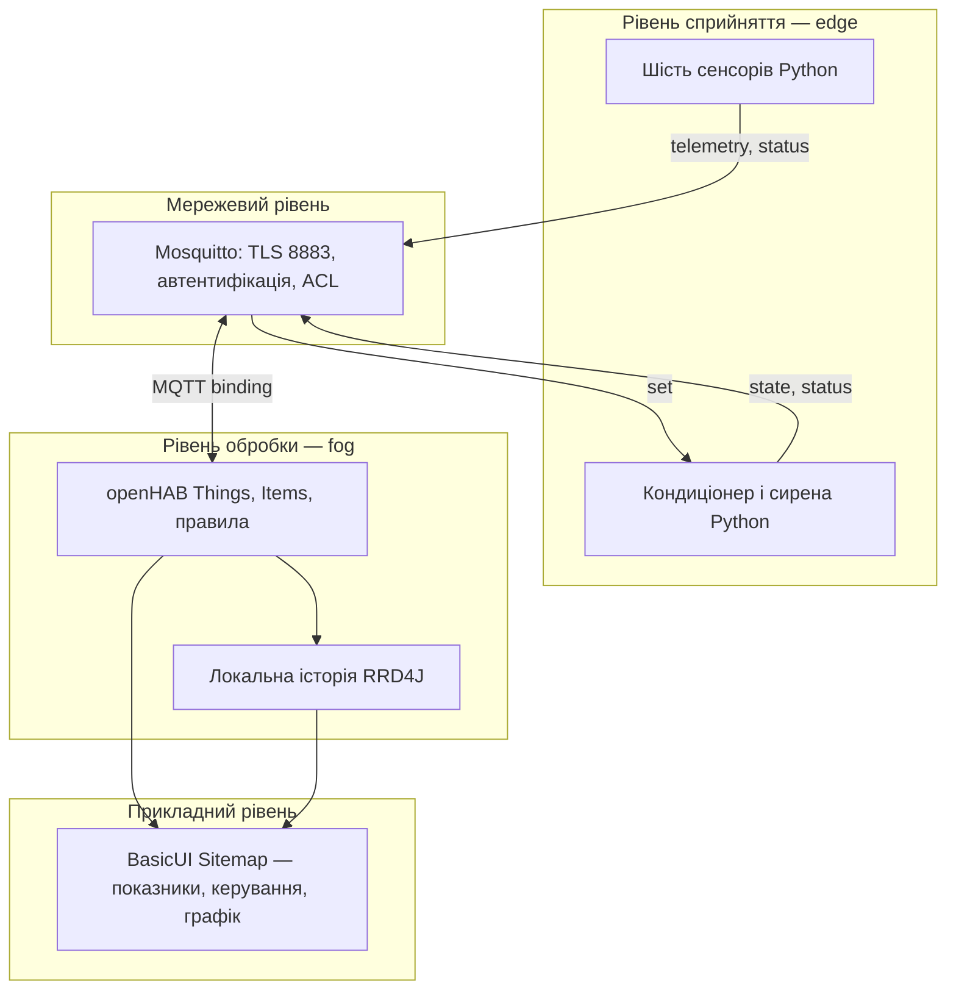

# Модульний контроль 1 — моніторинг серверної кімнати

**Варіант 2.** Python-пристрої → Mosquitto з TLS/ACL → openHAB → інтерфейс, графік, тривоги.
Обрано за дозволом користувача вибрати будь-який варіант. ПІБ та групу студент додає сам.

## Швидкий запуск

Потрібні Docker Engine/Desktop із Compose v2, Python 3.10+ та OpenSSL. На Windows
запускайте з WSL2 із підключеним Docker Desktop; на Linux/macOS — зі звичайного термінала.
Для першого завантаження образів, pip-пакета та openHAB add-ons потрібен інтернет.
Рекомендовано 4 ГБ вільної RAM і 3 ГБ диска.

У корені розпакованого проєкту виконайте **дві команди**:

```bash
python3 scripts/bootstrap.py
docker compose up -d
```

Підготовка генерує унікальні випадкові паролі, власний CA і серверний сертифікат,
хешує password_file штатним mosquitto_passwd та підставляє пароль openHAB у runtime-конфіг.
Залежності Python встановлюються всередині образу симулятора.
Часові інтервали **не прискорено**: дані кожні 2 с; watchdog кожні 5 с; тривога після >60 с.

```bash
docker compose ps
docker compose logs -f openhab
```

Перший запуск openHAB може тривати кілька хвилин. Відкрийте [MainUI](http://localhost:8080),
створіть локального адміністратора, якщо з'явиться майстер початкового налаштування.
Оберіть стандартний пакет, якщо майстер це запитає; add-ons задані у addons.cfg.
Потім відкрийте [готову Sitemap](http://localhost:8080/basicui/app?sitemap=server).
Новий графік спочатку порожній: зачекайте 1–2 хвилини для накопичення вимірів.

Зупинка без втрати історії: `docker compose down`. Повторний запуск: `docker compose up -d`.
`docker compose down -v` видаляє історію та обліковий запис openHAB — використовуйте лише для свідомого скидання.

## Архітектура: чотири рівні



Edge моделює фізичні виміри, перевіряє JSON-команди та застосовує стан актуаторів.
Fog — локальний openHAB: об'єднує сенсори, виконує правила, контролює свіжість даних
та зберігає історію. Хмара для роботи не потрібна: відсутність інтернету після встановлення
не перериває місцеві правила. На реальному обладнанні аварійне охолодження/сигналізацію
варто дублювати на edge, щоб відмова openHAB не блокувала фізичний захист.

MQTT підходить для невеликих частих вимірів і незалежних видавців/підписників у локальній
мережі серверної: один потік бачать і openHAB, і інструменти діагностики; доступні QoS,
retain та Last Will. HTTP потребував би окремої реалізації push/heartbeat, CoAP не дає
такої ж готової брокерної моделі, а Zigbee та LoRaWAN є іншими мережевими технологіями
і вимагали б радіообладнання/шлюзу, яких у цьому IP-стенді немає.

## Пристрої

| MQTT-користувач | Пристрій | Нормальні дані / керування |
|---|---|---|
| cold | Температура холодного коридору | ≈22 °C |
| hot | Температура гарячого коридору | ≈29 °C |
| humidity | Вологість | ≈45 % |
| leak | Датчик протікання | OFF / ON |
| door | Двері | CLOSED / OPEN |
| ups | ДБЖ | MAINS / BATTERY, заряд 0–100 % |
| ac | Кондиціонер | state: ON/OFF, mode: NORMAL/MAX |
| siren | Сирена з індикацією | state: ON/OFF, light: GREEN/YELLOW/RED |

Кожен пристрій — окремий Python-процес і MQTT-клієнт зі своїм паролем та Last Will.
Температура/вологість мають базовий рівень, синусоїдальний повільний тренд, обмежений шум
та інерцію. Дискретні аварії задаються відтворюваними сценаріями. Стан кондиціонера
підтверджується через MQTT; фізична модель теплообміну з кондиціонером не моделюється.

## MQTT-контракт

Префікс `office/server`. `d` — один із восьми ідентифікаторів пристрою.

| Топік | Хто публікує → читає | QoS | Retain | Приклад |
|---|---|---:|---|---|
| `office/server/<sensor>/telemetry` | sensor → openHAB | 1 | ні | `{"value":29.1,"unit":"C","ts":1793000000}` |
| `office/server/ups/telemetry` | ups → openHAB | 1 | ні | `{"mode":"BATTERY","battery":24,"unit":"%","ts":1793000000}` |
| `office/server/<actuator>/set` | openHAB → actuator | 1 | ні | `{"state":"ON"}` або `{"mode":"MAX"}` |
| `office/server/ac/state` | ac → openHAB | 1 | так | `{"state":"ON","mode":"MAX","ts":1793000000}` |
| `office/server/siren/state` | siren → openHAB | 1 | так | `{"state":"ON","light":"RED","ts":1793000000}` |
| `office/server/<d>/status` | d → openHAB | 1 | так | текст `online` / `offline` |

`ts` — Unix-час у секундах UTC; `status` — текст, решта — JSON UTF-8. Для leak поле
value дорівнює `ON`/`OFF`, для door — `OPEN`/`CLOSED`, для humidity unit — `%`.
Команди можуть оновлювати одне або кілька дозволених полів; порожні, невідомі й невалідні
поля відхиляються атомарно. Максимальна команда — 512 байтів, пакет брокера — 8192 байти.

QoS 1 обрано і для телеметрії, і для команд: частота мала, а втрата протікання/зміни ДБЖ
небажана. Повторні команди безпечні завдяки ідемпотентному встановленню стану, а не toggle.
QoS 2 не потрібен: додаткові обміни не дають тут практичної переваги. Підтвердження PUBACK
означає приймання брокером; виконання актуатором підтверджує саме `state`.
openHAB має `autoupdate=false`, тому UI показує підтверджений актуатором стан.
Команди без retain не виконуються повторно як застарілі накази після перезапуску.
Телеметрія без retain не видається за свіжий вимір; retained state завжди слід читати разом зі status.

Клієнт задає `offline` як retained Last Will **до** CONNECT, публікує retained `online`
після з'єднання; під час штатного виходу сам публікує `offline` і робить DISCONNECT.
Після SIGKILL брокер надсилає LWT після виявлення розриву (за keepalive 10 с — може бути затримка).

## Автоматизація openHAB

Текстові Things та Items містяться в `openhab/conf`. Пароль у шаблоні відсутній;
робочий `.things` генерується лише в `.runtime/openhab-conf/things/`.
Rules реалізовані через офіційний add-on JavaScript Scripting, а не Rules DSL:
`automation/js/server.js` реєструє три основні правила та watchdog.

| Правило | Умова | Результат |
|---|---|---|
| 1. Перегрів | hot >35 °C | AC ON, MAX; жовтий індикатор |
| 1. Критичний перегрів | hot >40 °C | AC MAX, сирена ON, червоний індикатор, повідомлення |
| 2. Протікання | leak ON, незалежно від температури/ДБЖ | сирена ON, повідомлення |
| 3. Резервне живлення | BATTERY і battery <30 % | «Підготувати сервери до вимкнення», сирена ON |
| Особлива вимога | температура offline >60 с | «Немає даних», сирена ON |
| Додатковий watchdog | будь-який із 6 сенсорів offline або не надсилає дані >60 с | «Немає даних», сирена ON |

Усі причини об'єднуються функцією reconcile; усунення перегріву не скидає сирену при
активному протіканні/ДБЖ/втраті сенсора. Відновлення всіх умов автоматично очищає тривогу.
Пороги строгі: рівно 35/40 °C та 30 % ще не перетинають відповідний поріг.
Після перегріву AC вимикається при <33 °C; 33–35 °C — гістерезис із збереженням стану.
При втраті температури останній стан AC зберігається, і вмикається сигналізація.
Автоматика має пріоритет над ручними командами UI та повторює потрібні команди,
поки не одержить відповідний state. Щоб демонструвати ручне керування, враховуйте цей пріоритет.
Watchdog перевіряє стани кожні 5 с, тому тривога настає в межах наступного циклу після 60 с.
Після запуску/перезавантаження JS є нове вікно 60 с на отримання перших даних.

RRD4J зберігає числові дані кожні 10 с і при змінах; Sitemap містить графік обох температур
за останню годину. Історія зберігається в іменованому Docker volume.

## Демонстраційні сценарії

Команди змінюють спільний локальний файл сценарію, а не публікують службові накази
в MQTT з надлишковими правами сенсорів. Одночасно активний один сценарій.

```bash
docker compose exec simulator python devices.py --scenario normal
docker compose exec simulator python devices.py --scenario hot
docker compose exec simulator python devices.py --scenario critical
docker compose exec simulator python devices.py --scenario leak
docker compose exec simulator python devices.py --scenario ups
docker compose exec simulator python devices.py --scenario combined
docker compose exec simulator python devices.py --scenario offline-hot
docker compose exec simulator python devices.py --scenario normal
```

hot плавно наближається до 37.2 °C, critical/combined — до 42.2 °C; дочекайтеся 10–20 с.
combined одночасно активує критичну температуру, протікання та низький заряд.
offline-hot робить SIGKILL лише процесу hot; supervisor не відновлює його до зміни сценарію.
Для демонстрації особливої вимоги зачекайте >60 с і ще до 5 с на watchdog.
Додатково є `offline-cold`, `silent-hot` (сеанс online без телеметрії) і `door`.
Після кожної окремої демонстрації поверніть `normal`; температура повертається плавно.

## Перевірки

```bash
# Після запуску в normal: 8 статусів, 6 потоків, state актуаторів.
docker compose run --rm tools scripts/smoke.py
# Спроби без пароля, без TLS, порт 1883, чужий топік від користувача cold.
docker compose run --rm tools scripts/security_check.py
# Перегляд потоків (Ctrl+C — вихід).
docker compose run --rm tools scripts/watch.py
docker compose logs --since 5m mosquitto
```

Негативна перевірка ACL використовує MQTT 5 та очікує PUBACK `Not authorized` (0x87).
Нульовий exit код звичайного MQTT 3.1.1 видавця не є доказом дозволеного запису.

Локальні перевірки без Docker:

```bash
python3 -m unittest discover -s tests -p 'test_*.py' -v
node --test tests/*.test.js
```

Node.js 18+ потрібен лише для тестів, у Docker-системі правила виконує GraalJS.
Додатковий native integration test описаний у `tests/native_integration.py`.
Результати виконаних перевірок і межі перевірки — у [docs/VALIDATION.md](docs/VALIDATION.md).

## Безпека

- Єдиний listener брокера — TLS 8883; 1883 не відкривається навіть усередині Docker-мережі.
- Порти хоста 8883 та 8080 прив'язані до 127.0.0.1. MainUI доступний тільки локально.
- Кожен пристрій, openHAB та admin мають різні паролі; anonymous вимкнено.
- Сенсор пише лише власні telemetry/status; актуатор читає лише власний set і пише state/status.
- openHAB читає виміри/стани та пише тільки ac/set і siren/set; admin керує office/server/#.
- Python перевіряє CA/hostname; SAN охоплює mosquitto, localhost і 127.0.0.1.
- CA імпортується у стандартний Java truststore при складанні openHAB; insecure TLS не використано.
- TLS мінімум 1.2. Серверний ключ доступний лише брокеру; приватний CA-ключ не монтується.
- `.env`, runtime-конфіг із паролем, хеші та ключі виключені з git і з ZIP.
- tools одержує admin/cold лише для перевірок; simulator не отримує admin/openhab паролі.

Модель STRIDE — [docs/THREAT_MODEL.md](docs/THREAT_MODEL.md).
Це навчальний стенд: усі device-процеси в одному контейнері; компрометація контейнера
відкриває його device-паролі. Для фізичної системи кожному пристрою потрібне окреме сховище
секретів, а також резервний контролер і джерело живлення. Обліковий запис адміністратора
openHAB та MQTT-admin — різні облікові записи.

## Зміна конфігурації та діагностика

Редагуйте вихідні файли `openhab/conf`, потім при зупиненій системі:

```bash
docker compose down
python3 scripts/bootstrap.py
docker compose up -d
```

Повторна підготовка зберігає наявні паролі та сертифікати й синхронізує конфігурацію.
Для зміни порогу на захисті достатньо редагувати порівняння в `automation/js/node_modules/server-policy/index.js`, синхронізувати
конфіг або відредагувати runtime-копію (потім перенесіть зміну у вихідний код).
CA чинний 10 років, серверний сертифікат — 1 рік. При свідомій ротації зупиніть систему,
зробіть резервну копію runtime, згенеруйте новий комплект і перебудуйте openhab:
`docker compose build --no-cache openhab`, потім `docker compose up -d`.

Якщо MQTT Thing OFFLINE: перевірте логи брокера, addons і server.things, CA та час системи.
Якщо Items NULL: дочекайтеся встановлення add-ons, звірте status/ACL і telemetry через watch.py.
Якщо графік порожній: дочекайтеся записів, перевірте rrd4j у логах; перша година ще не заповнена.
Якщо Docker не може читати bind mount: запускайте з локального каталогу WSL/Linux,
доступного Docker, та повторіть bootstrap. Секрети й логи з паролями не публікуйте.

## Джерела

- [openHAB 4.3 MQTT](https://v43.openhab.org/addons/bindings/mqtt/)
- [openHAB 4.3 Generic MQTT Things](https://v43.openhab.org/addons/bindings/mqtt.generic/)
- [JavaScript Scripting 4.3](https://v43.openhab.org/addons/automation/jsscripting/)
- [openHAB Docker](https://www.openhab.org/docs/installation/docker.html)
- [RRD4J](https://v43.openhab.org/addons/persistence/rrd4j/)
- [Mosquitto configuration](https://mosquitto.org/man/mosquitto-conf-5.html)
- [Paho MQTT Python](https://eclipse.dev/paho/files/paho.mqtt.python/html/)

Версії стенда зафіксовано: openHAB 4.3.3-debian, Mosquitto 2.0.21,
Python 3.12-slim, paho-mqtt 2.1.0; для openHAB використано документацію гілки 4.3.
